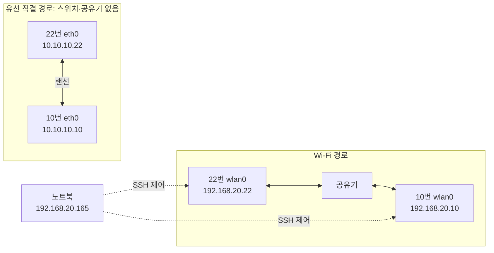
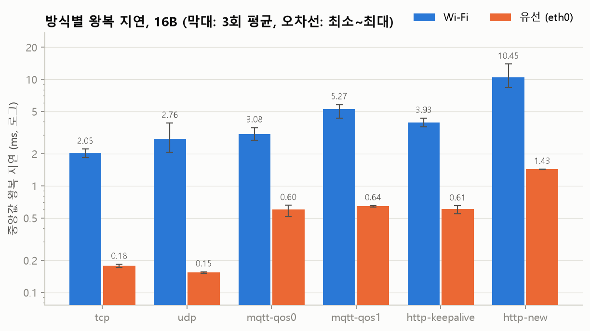
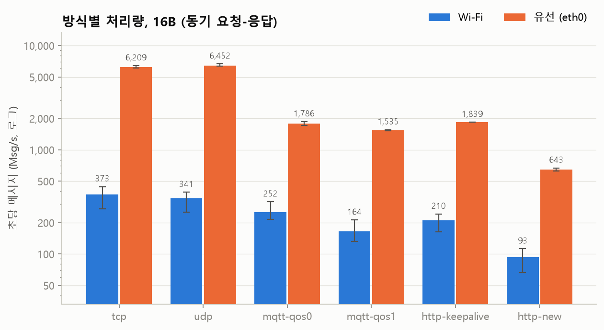
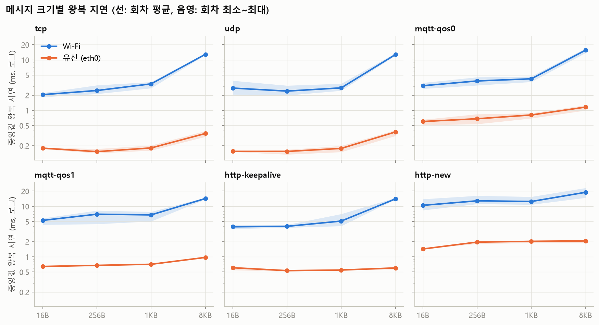
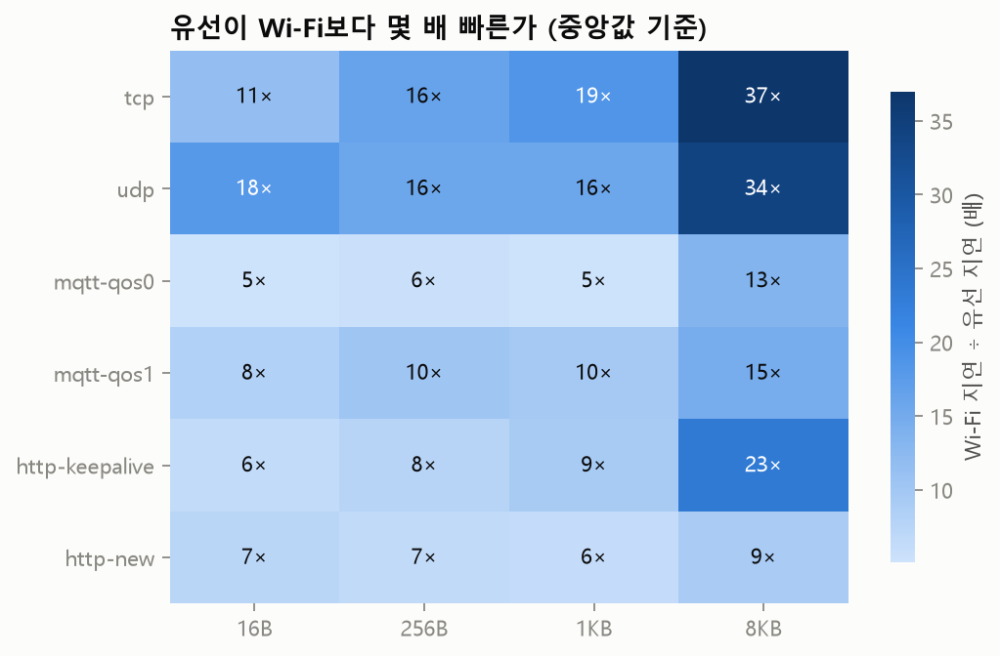
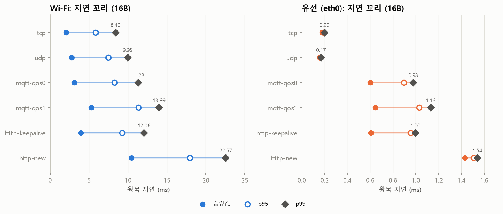
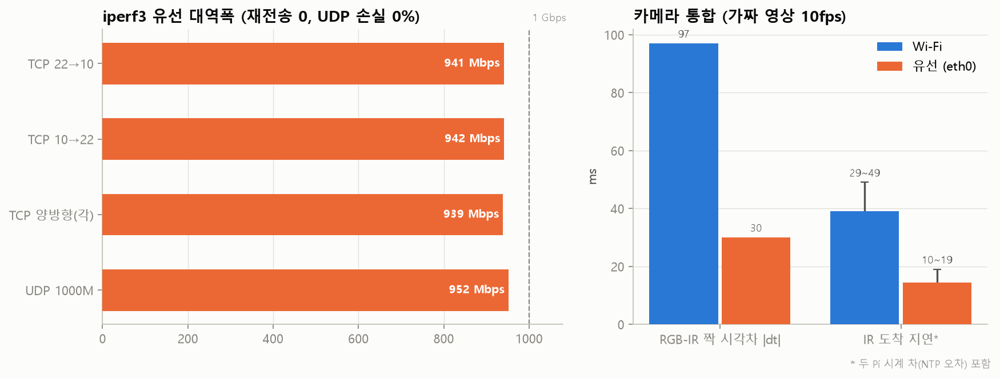

# 라즈베리파이 Wi-Fi·유선 직결 통신 비교 보고서

- 측정일: 2026-11-26
- 장비: Raspberry Pi 4B 두 대, 22번 `rpi-syw3480`(송신), 10번 `rpi-lyb3550`(브로커·에코·통합 수신)
- 작성: 1·2·3·7절 Codex(GPT-6.1 Sol), 0·4·5·6절 Antigravity(Gemini 4 Neon). 두 저자가 서로의 절을 검토하고 고쳐 썼고, Claude가 합치면서 수치와 코드 설명을 원본 데이터와 대조했다.
- 원본 데이터: `comm_bench/results/`, `eth0_link/results/`, `mqtt_cam/results/`

## 목차
0. 한눈에 보는 결론
1. 목적과 배경
2. 실험 환경
3. 측정 방법
4. 결과
5. 분석
6. 한계와 다음 단계
7. 재현 방법

## 0. 한눈에 보는 결론

- **유선 직결(eth0)의 물리 성능은 1 GbE 이론 한계에 도달했다.** `iperf3` 측정에서 단방향 TCP 941~942 Mbps, 양방향 동시 939 + 939 Mbps, UDP 952 Mbps를 손실·재전송 0%로 기록했으며, `ping` 왕복 지연은 평균 0.137 ms였다.
- **6가지 통신 방식과 4가지 메시지 크기(총 24개 조합) 전부에서 유선이 Wi-Fi보다 5.1~37.0배 빨랐다.** 16B 기준 왕복 지연 중앙값(3회 평균)은 `tcp`가 2.05 ms에서 0.178 ms(11.5배), `mqtt-qos0`이 3.08 ms에서 0.602 ms(5.1배)로 줄었다. 모든 조건에서 측정한 응용 메시지의 응답 손실률은 0%였으며, TCP 내부 재전송과 무선 계층 손실은 별도로 측정하지 않았다.
- **메시지가 8KB로 커지면 Wi-Fi 지연이 급격히 늘어 격차가 극대화된다.** 8KB에서 `tcp` 중앙값은 Wi-Fi 12.9 ms, 유선 0.348 ms로 37.0배 차이가 났고, 프로젝트에 쓰는 `mqtt-qos0`도 15.6 ms 대 1.16 ms(13.4배)까지 벌어졌다.
- **유선은 지연 꼬리와 회차 간 변동이 거의 없어 훨씬 안정적이다.** Wi-Fi는 16B `tcp`에서도 회차별 p99 평균이 8.40 ms, 1KB에서는 p99 평균 54.1 ms(관측 최대 147 ms)까지 튀었지만, 유선은 전체 24개 조건에서 회차별 p99 평균이 0.16~2.27 ms(8KB에서도 0.40~2.27 ms), 조건별 관측 최대값이 0.2~2.7 ms 이내였다.
- **카메라 통합 테스트에서도 유선 전환 후 관측 지표가 개선됐다.** 640×480 10 fps 가짜 영상(약 16 KB JPEG)을 MQTT로 전송할 때 관측된 평균 시각 차(`|dt|`)가 Wi-Fi 약 97 ms에서 유선 약 30 ms로, IR 도착 지연이 29~49 ms에서 10~19 ms로 줄고 짝 성공률 하한도 84%에서 92%로 올라갔다. 다만 `|dt|`와 IR 도착 지연에는 두 Pi 간 시계 차가 섞여 있어 전송 경로만의 효과로 단정할 수는 없다.

## 1. 목적과 배경

라즈베리파이 두 대를 Wi-Fi와 랜선 직결로 연결하여 통신 방식에 따른 왕복 지연, 처리량, 손실률을 비교한다.
왕복 지연은 요청을 보낸 뒤 응답을 받을 때까지 걸리는 시간이며, 처리량은 단위 시간에 처리를 완료한 메시지 수다.
텍스트 통신 비교와 함께 유선 전송 성능 측정, 가짜 영상을 이용한 카메라 통합 테스트를 수행한다.

원래 구성에서는 49번이 수신과 중계를 맡았으나, 네트워크에서 접속되지 않아 10번으로 교체했다.
송신은 22번이 담당하며, 프로그램 코드 대신 `--host`와 `--broker` 옵션으로 상대 주소를 지정한다.

## 2. 실험 환경

두 라즈베리파이는 모두 Raspberry Pi 4 Model B Rev 1.5이며, 운영체제는 Debian GNU/Linux 13(trixie), 사용자 계정은 `linux`다.

| 장비 | 호스트명·환경 | 역할 |
|---|---|---|
| 22번 Pi | `rpi-syw3480` | 통신 측정 클라이언트, iperf3 클라이언트, NoIR 카메라 송신 담당 |
| 10번 Pi | `rpi-lyb3550` | MQTT 브로커, 에코 서버, 영상 통합 수신, iperf3 서버 |
| 노트북 | Windows, PowerShell | 원격 제어, 파일 복사, 결과 회수와 그래프 생성 |

SSH는 다른 장비에서 명령을 실행하는 원격 접속 방식이며, 노트북에서 두 Pi의 Wi-Fi 주소로 접속한다.
측정 데이터는 실행 옵션에 지정한 상대 주소에 따라 Wi-Fi 또는 유선으로 전송한다.

IP 주소는 네트워크에서 장비의 통신 위치를 나타내며, `wlan0`은 Wi-Fi 인터페이스, `eth0`은 유선 인터페이스다.

| 장비 | Wi-Fi 주소 | 유선 직결 주소 |
|---|---|---|
| 22번 Pi | `192.168.20.22` | `10.10.10.22/24` |
| 10번 Pi | `192.168.20.10` | `10.10.10.10/24` |
| 노트북 | `192.168.20.165` | 측정용 직결 구성에 포함하지 않음 |

`/24`는 같은 네트워크에 속하는 주소의 범위를 표시한다.
Wi-Fi는 공유기를 거치는 `192.168.20.0/24` 대역이며, 유선은 두 Pi를 랜선 한 가닥으로 직접 연결한다.



두 경로의 22번 표시는 같은 장비를, 10번 표시는 같은 장비를 뜻한다.
유선 링크 속도는 1000 Mbps이며, 양방향으로 동시에 통신하는 전이중 방식이다.
MTU는 한 번에 전송하는 IP 패킷의 최대 크기를 뜻하며, 유선 설정은 1500바이트다.

NetworkManager는 네트워크 연결 설정을 관리하는 프로그램이다.
`eth0_link/pi-eth0-setup.sh`는 `p2p-eth0` 프로필에 `ipv4.method manual`로 고정 주소를 설정한다.
`ipv4.never-default yes`는 유선을 인터넷 기본 경로로 사용하지 않고 Wi-Fi 기본 경로를 유지한다는 뜻이다.
프로필은 자동 연결되므로 재부팅 후에도 유지되며, `ip route get`으로 상대 유선 주소가 `dev eth0`을 사용하는지 확인한다.
랜선 연결만으로 측정 경로가 바뀌지는 않으므로, 유선 측정에는 반드시 `10.10.10.x` 주소를 사용한다.

MQTT는 주제별 메시지 발행·구독 방식이며, 브로커는 발행된 메시지를 구독자에게 중계하는 서버다.
10번에서 Mosquitto 브로커를 실행하며, `/etc/mosquitto/conf.d/lan.conf`의 설정은 다음과 같다.

```text
listener 1883 0.0.0.0
allow_anonymous true
set_tcp_nodelay true
```

1883번 포트에서 모든 인터페이스의 접속을 받고, 같은 공유기 안 테스트를 위해 익명 접속을 허용한다.
`set_tcp_nodelay true`는 브로커의 TCP 소켓에 `TCP_NODELAY`를 적용하여 작은 메시지를 모아서 보내는 동작에 따른 지연을 줄이기 위한 설정이다.
브로커 설정 스크립트는 `eth0_link/broker-setup-10.sh`이며, 노트북 실행기는 `eth0_link/setup-broker-10.ps1`이다.

## 3. 측정 방법

### 3.1 iperf3·ping

iperf3는 일정 시간 데이터를 전송하여 네트워크 전송률을 측정하는 도구다.
10번을 서버, 22번을 클라이언트로 두고 유선 직결 경로를 측정한다.
TCP는 연결을 맺고 데이터 재전송을 처리하는 방식이며, UDP는 연결 수립 없이 데이터그램 단위로 전송하는 방식이다.
TCP는 22→10과 10→22 방향을 각각 10초씩 3회 측정하고, `--bidir`로 양방향 동시 전송도 측정한다.
UDP는 목표 전송률을 `1000M`으로 지정하고 수신 전송률, 손실, 지터를 기록한다.
지터는 패킷 도착 간격의 변동을 뜻한다.

ping은 상대 장비의 응답으로 왕복 시간과 손실을 확인하는 도구다.
원본 측정 조건은 0.2초 간격의 ping 50회다.
7절의 보조 점검 스크립트는 양방향 ping을 각각 30회 수행하므로 이 조건과 구분한다.
이 실험에서는 Wi-Fi 경로의 iperf3 측정을 수행하지 않았다.

### 3.2 통신 방식 비교

22번의 `bench_client.py`가 메시지를 보내고, 10번의 `bench_server.py`가 받은 내용을 그대로 반환한다.
이처럼 받은 내용을 돌려주는 동작을 에코라고 한다.
RTT는 요청 전송부터 에코 수신까지의 왕복 시간이며, 22번의 `time.perf_counter()` 하나로 측정한다.
송신과 수신 시각을 같은 장비의 시계로 기록하므로 두 Pi 사이의 시계 차이가 RTT에 포함되지 않는다.

HTTP는 요청과 응답으로 통신하는 방식이며, 연결 재사용 여부를 나누어 비교한다.
MQTT의 QoS는 전달 보장 수준으로, QoS 0은 전달 보장 없이 보내고 QoS 1은 최소 한 번 전달을 보장하는 방식이다.

| 방식 | 비교 조건 |
|---|---|
| `tcp` | 연결 재사용, 4바이트 길이 헤더, `TCP_NODELAY` 적용 |
| `udp` | 시퀀스 번호로 응답을 구분하고 타임아웃을 손실로 처리 |
| `http-keepalive` | HTTP/1.1 연결 재사용 |
| `http-new` | 요청마다 새 연결 생성 |
| `mqtt-qos0` | 10번 브로커를 경유하며 QoS 0 적용 |
| `mqtt-qos1` | 10번 브로커를 경유하며 QoS 1 적용 |

프로그램의 `TCP_NODELAY`와 2절의 Mosquitto `set_tcp_nodelay`는 작은 메시지를 모아서 보내는 동작을 끈다는 목적이 같다.
다만 각각 프로그램의 소켓과 브로커의 소켓에 적용한다.
브로커와 에코 서버가 같은 10번 Pi에 있으므로 MQTT 중계 경로 일부는 장비 내부를 지난다.

페이로드는 메시지에 담는 본문 데이터이며, 크기는 16·256·1024·8192바이트로 구분한다.
이 크기에는 실행 식별값과 시퀀스 번호를 담은 16바이트 식별자가 포함되며, TCP 길이 헤더와 HTTP·MQTT 등의 프로토콜 헤더는 제외한다.
각 방식과 크기의 조합마다 예열 20회, RTT 측정 500회, 처리량 측정 5초를 적용하고 응답 타임아웃은 1초로 둔다.
처리량은 응답을 받거나 타임아웃이 발생한 뒤 다음 요청을 보내는 동기 방식으로 측정한다.

Wi-Fi 측정 후 유선 측정을 수행하는 순서로 3회 반복하여 총 6회 실행한다.
평균·중앙값·p95·p99·최대 RTT, 초당 메시지 수, 손실률을 기록한다.
RTT 통계는 성공 응답을 대상으로 계산하며, p95와 p99는 각각 성공 응답의 약 95%, 99%가 해당 시간 안에 도착하는 지연 기준이다.
측정 중에는 카메라 전송과 다른 대용량 전송을 중단하며, 오류가 있는 실행은 정상 측정과 구분한다.

### 3.3 카메라 통합 테스트

실제 카메라는 연결하지 않았으며, 640×480 크기의 가짜 영상을 초당 10프레임으로 생성한다.
22번의 `mqtt_cam/ir_sender.py`가 JPEG 프레임을 `cam/ir` 주제로 QoS 0으로 발행한다.
10번의 `mqtt_cam/fusion_receiver.py`는 받은 IR 영상 중 RGB 영상의 생성 시각과 가장 가까운 프레임을 선택하며, 시각 차이가 기본 허용 범위인 0.15초 이내이면 짝지어 겹친다.
Wi-Fi와 유선 주소를 각각 브로커로 지정하여 경로별 약 30초씩 실행한다.

수신 프레임률, 짝 성공률, 짝지은 영상의 평균 절대 시각 차이 `|dt|`, IR 도착 지연을 기록한다.
코드의 `dt = m[0] - t`에서 `m[0]`은 22번이 기록한 IR 촬영 시각이며, 가짜 영상에서는 IR 생성 시작 시각이다.
`t`는 10번에서 기록한 RGB 생성 시각이다.
따라서 `|dt|`에는 프레임 생성 시점의 차이와 두 Pi의 시계 차이가 함께 포함된다.

IR 도착 지연은 10번에서 IR 프레임을 수신·디코딩한 뒤의 시각에서 22번이 기록한 IR 시각을 빼서 구하므로, 이 값에도 두 Pi의 시계 차이가 포함된다.
두 지표 모두 같은 장비의 시계로 재는 텍스트 RTT와 구분한다.
NTP는 네트워크를 통한 시계 동기화 방식이며, 두 Pi에서 `NTPSynchronized=yes` 상태를 확인했지만 이것이 시계 차이가 완전히 없음을 뜻하지는 않는다.

통합 화면은 노트북 브라우저에서 `http://192.168.20.10:8080`으로 확인한다.
프로그램 화면과 일부 설명에 남아 있는 `RGB (49)` 표시는 기존 장비 이름이며, 이번 실행에서 실제 수신 장비는 10번이다.

## 4. 결과

### 4.1 유선 링크 대역폭

실험 구성과 절차는 2~3절을 참고한다. 유선 직결(`eth0`) 구간의 `iperf3` 및 `ping` 측정 결과는 다음과 같다.

| 측정 항목 | 결과 | 손실·재전송 / 비고 |
|---|---|---|
| TCP 22→10 (3회) | 941 / 941 / 941 Mbps | 재전송 0회 |
| TCP 10→22 (3회) | 942 / 942 / 942 Mbps | 재전송 0회 |
| TCP 양방향 동시(`--bidir`) | 939 + 939 Mbps | 재전송 0회 |
| UDP (1000 Mbps 목표) | 952 Mbps | 손실 0 / 822,052 (0%), 지터 0.013 ms |
| ping (50회, 0.2초 간격) | 평균 0.137 ms | 최소 0.095, 최대 0.206, mdev 0.024 ms, 손실 0% |

1 GbE·MTU 1500 환경에서 TCP 실효 최대치는 약 941 Mbps이므로, 두 라즈베리파이 간 유선 직결 링크는 병목 없이 대역폭을 사실상 100% 활용했다. 양방향 동시 전송에서도 송수신 각각 939 Mbps가 유지됐고, UDP 1 Gbps 부하에서도 패킷 손실 없이 지터 0.013 ms를 기록했다. 참고로 Wi-Fi 경로는 `iperf3` 측정을 수행하지 않았다.

### 4.2 방식별 왕복 지연과 처리량

실험 구성과 절차는 2~3절을 참고한다. `comm_bench` 전체 24개 조합(두 경로 총 48개 조건)에서 측정한 응용 메시지의 응답 손실률은 모두 0%였다(TCP 내부 재전송과 무선 계층 손실은 별도로 측정하지 않았다). 16B 메시지 기준 회차별 통계의 3회 평균 결과는 다음과 같다.

| 방식 | Wi-Fi 중앙값 ms | 유선 중앙값 ms | 배수 | Wi-Fi Msg/s | 유선 Msg/s |
|---|---:|---:|---:|---:|---:|
| tcp | 2.05 | 0.178 | 11.5배 | 373 | 6,209 |
| udp | 2.76 | 0.154 | 17.9배 | 341 | 6,452 |
| mqtt-qos0 | 3.08 | 0.602 | 5.1배 | 252 | 1,786 |
| mqtt-qos1 | 5.27 | 0.643 | 8.2배 | 164 | 1,535 |
| http-keepalive | 3.94 | 0.607 | 6.5배 | 210 | 1,839 |
| http-new | 10.46 | 1.43 | 7.3배 | 93 | 643 |

유선에서는 `udp`(0.154 ms, 6,452 Msg/s)와 `tcp`(0.178 ms, 6,209 Msg/s)가 가장 빨랐고, `mqtt-qos0`(0.602 ms)·`http-keepalive`(0.607 ms)·`mqtt-qos1`(0.643 ms)가 중간 그룹을 형성했으며, `http-new`(1.43 ms, 643 Msg/s)가 가장 느렸다. Wi-Fi에서도 큰 순서는 비슷했으나 `tcp`(2.05 ms)가 `udp`(2.76 ms)보다 소폭 빨랐고, `mqtt-qos1`(5.27 ms)이 `http-keepalive`(3.94 ms)보다 느렸다. 처리량은 응답을 받은 뒤 다음 요청을 보내는 동기식 측정이므로 지연이 짧은 방식일수록 높았으며, 유선으로 바꾸면 `udp`는 18.9배, `tcp`는 16.6배, `mqtt-qos0`은 7.1배 처리량이 늘었다. 전체 수치는 인터랙티브 웹 대시보드(별도 공유 링크)에서도 조건별로 확인할 수 있다.





### 4.3 메시지 크기의 영향

메시지 크기를 16B, 256B, 1KB(1,024B), 8KB(8,192B)로 키웠을 때 두 경로의 지연 변화 양상은 크게 달랐다. Wi-Fi에서는 16B~1KB 구간에서 방식에 따라 증감이 섞였으나(예: `udp` 16B 2.76 ms → 256B 2.41 ms, `mqtt-qos1` 256B 6.97 ms → 1KB 6.77 ms, `http-new` 256B 12.83 ms → 1KB 12.46 ms), **1KB→8KB 구간에서는 모든 방식의 중앙값이 급격히 증가했다**. 반면 유선에서는 16B~1KB 구간의 변동 폭이 작았고 8KB에서도 증가 폭이 제한적이었다.

| 방식 | Wi-Fi 1KB→8KB (ms) | 유선 1KB→8KB (ms) | 8KB 배수 | Wi-Fi 8KB Msg/s | 유선 8KB Msg/s |
|---|---:|---:|---:|---:|---:|
| tcp | 3.35 → 12.9 | 0.180 → 0.348 | 37.0배 | 72 | 2,966 |
| udp | 2.79 → 12.7 | 0.176 → 0.373 | 34.1배 | 71 | 2,466 |
| mqtt-qos0 | 4.22 → 15.6 | 0.811 → 1.16 | 13.4배 | 63 | 803 |
| mqtt-qos1 | 6.77 → 14.2 | 0.711 → 0.972 | 14.7배 | 67 | 999 |
| http-keepalive | 5.10 → 14.0 | 0.547 → 0.602 | 23.3배 | 68 | 1,685 |
| http-new | 12.5 → 18.9 | 2.03 → 2.07 | 9.2배 | 52 | 483 |

이 차이 때문에 유선 대비 Wi-Fi 지연 배수(`fig5` 히트맵)는 모든 방식에서 8KB일 때 가장 커졌다. 24개 조합 전체의 배수는 5.1배(`mqtt-qos0` 16B)에서 37.0배(`tcp` 8KB) 범위였으며, Wi-Fi 처리량도 1KB 대비 8KB에서 `tcp` 277 → 72 Msg/s, `udp` 294 → 71 Msg/s, `mqtt-qos0` 197 → 63 Msg/s로 크게 떨어졌다.





### 4.4 지연 꼬리와 안정성

실시간 통신에서는 중앙값뿐 아니라 상위 지연(p95, p99)과 반복 측정 시 일관성이 중요하다. 이하 중앙값·p95·p99는 각각 회차별 통계의 3회 평균이며, 최대값은 3회 중 관측 최대값이다(전체 1,500개 응답을 합쳐 다시 계산한 분위수가 아니다). `fig4`에서 확인되듯 Wi-Fi는 꼬리 지연이 길고 편차가 큰 반면, 유선은 중앙값과 p99가 거의 붙어 있다.

- **16B 지연 꼬리(중앙값 / p95 / p99)**: Wi-Fi는 `tcp` 2.05 / 5.86 / 8.40 ms, `udp` 2.76 / 7.47 / 9.95 ms, `mqtt-qos0` 3.08 / 8.24 / 11.3 ms, `http-new` 10.46 / 17.9 / 22.6 ms로 중앙값 대비 p99가 2~4배 이상 벌어졌다. 반면 유선은 `tcp` 0.178 / 0.19 / 0.20 ms, `udp` 0.154 / 0.16 / 0.17 ms, `mqtt-qos0` 0.602 / 0.90 / 0.98 ms, `http-new` 1.43 / 1.51 / 1.54 ms로 꼬리가 매우 짧았다.
- **전체 조건의 상위 지연과 스파이크**: Wi-Fi에서는 `tcp` 1KB의 p99 평균이 54.1 ms(최대 147 ms), `http-keepalive` 8KB의 p99 평균이 60.5 ms(최대 142 ms), `http-new` 8KB의 p99 평균이 77.2 ms(최대 156 ms), `mqtt-qos0` 1KB의 최대값이 103 ms까지 치솟았다. 반면 유선 전체 24개 조건의 회차별 p99 평균은 0.16~2.27 ms(8KB 구간만 보면 0.40~2.27 ms), 조건별 관측 최대값은 0.2~2.7 ms였다.
- **회차 간 흔들림(3회 최소~최대)**: Wi-Fi는 같은 조건에서도 회차 편차가 컸다(`udp` 16B 중앙값 2.07~3.88 ms, `http-new` 16B 8.36~13.9 ms, `http-keepalive` 256B 처리량 81~223 Msg/s). 반대로 유선은 `tcp` 16B 0.172~0.184 ms, `udp` 16B 0.150~0.156 ms, `http-new` 16B 1.42~1.44 ms로 회차 간 재현성이 높았다.



### 4.5 카메라 통합 테스트

실험 구성과 절차는 2~3절을 참고한다. 두 경로 모두 브라우저 확인(`http://192.168.20.10:8080`, HTTP 200)을 마쳤으며, 측정 결과는 다음과 같다.

| 경로(브로커 주소) | IR 수신 속도 | 짝 성공률 | 평균 `\|dt\|` | IR 도착 지연 |
|---|---|---|---|---|
| Wi-Fi (`192.168.20.10`) | 9.9~10 fps | 84~100% | 95~98 ms (약 97 ms) | 29~49 ms |
| 유선 (`10.10.10.10`) | 9~10 fps | 92~100% (첫 5초 예열 16% 제외) | 29~31 ms (약 30 ms) | 10~19 ms |

Wi-Fi 결과는 원래 가이드의 22번↔49번 Wi-Fi 기록(짝 성공 98~100%, IR 도착 지연 약 33 ms, `dt` 약 112 ms)과 유사한 범위였다. 유선으로 경로를 바꾼 뒤에는 관측된 평균 `|dt|`가 약 97 ms에서 약 30 ms로, IR 도착 지연이 29~49 ms에서 10~19 ms로 줄었고, 짝 성공률 하한도 84%에서 92%로 올라갔다.

다만 **`|dt|`와 IR 도착 지연 수치 해석에는 모두 주의가 필요하다**. `comm_bench`는 22번 단일 시계로 왕복 시간을 잰 반면, `fusion_receiver.py`의 `|dt|`는 22번이 찍은 IR 촬영 시각과 10번의 RGB 생성 시각의 차이(`dt = m[0] - t`)로 계산되고, IR 도착 지연 역시 22번 송신 시각과 10번 수신 시각의 차이로 계산된다. 두 Pi 모두 `NTPSynchronized=yes` 상태였으나 밀리초 단위의 잔여 시계 차와 프레임 생성 시점 차이가 함께 섞이므로, 관측된 평균 `|dt|` 감소(약 97 → 30 ms)와 IR 도착 지연 감소(29~49 → 10~19 ms)를 전송 경로만의 효과로 분리해 단정할 수는 없다.



## 5. 분석

### 5.1 통신 방식 간 지연 차이

방식 간 순위가 발생하는 주된 원인은 프로토콜 구조에 따른 단계 수와 처리 비용 차이다. `udp`와 `tcp`는 중계 서버나 텍스트 헤더 없이 커널 소켓을 직접 사용하며, `tcp` 역시 연결을 재사용하고 `TCP_NODELAY`를 켠 상태에서 4바이트 길이 헤더만 붙여 가장 빠른 그룹을 이뤘다. 반면 MQTT(`mqtt-qos0`, `mqtt-qos1`)는 10번 Pi의 `mosquitto` 브로커를 거치므로 왕복 한 번에 클라이언트→브로커→에코 서버→브로커→클라이언트 경로가 형성돼 중계 홉과 라우팅 비용이 추가된다. `http-keepalive`는 TCP 연결을 재사용하지만 매 요청·응답마다 HTTP 헤더 생성과 파싱이 필요해 원시 TCP보다 느렸고, `http-new`는 매 요청마다 TCP 연결 수립과 종료를 반복해 모든 방식 중 가장 느렸다.

`mqtt-qos1`과 `mqtt-qos0`의 관계는 단순하지 않다. 프로토콜상 `mqtt-qos1`에는 수신 확인(`PUBACK`) 절차가 추가되지만, `comm_bench`의 `mqtt-qos1` RTT는 `PUBACK` 완료 시점이 아니라 에코 메시지가 돌아온 시점을 기준으로 측정한다. 실제로 Wi-Fi 16B~1KB에서는 `mqtt-qos1`이 `mqtt-qos0`보다 느렸으나(예: 16B 5.27 ms 대 3.08 ms), 유선 256B~8KB(예: 1KB 0.711 ms 대 0.811 ms, 8KB 0.972 ms 대 1.16 ms)와 Wi-Fi 8KB(14.2 ms 대 15.6 ms)에서는 오히려 `mqtt-qos1` 중앙값이 더 낮게 관측됐다. 따라서 두 방식의 지연 차이를 `PUBACK` 비용만으로 설명할 수는 없으며, 무선 환경 변동이나 `mosquitto`·클라이언트 내부 버퍼링 및 처리 흐름 차이의 영향으로 **추정**된다.

### 5.2 유선의 짧은 지연과 소프트웨어 처리 비용

유선 직결에서는 `ping` 평균이 0.137 ms, 16B `udp`가 0.154 ms, `tcp`가 0.178 ms로 기본 왕복 지연 자체가 매우 짧았다. 그런데 같은 유선 환경에서 `mqtt-qos0`(0.602 ms)과 `http-keepalive`(0.607 ms)는 `tcp`보다 약 0.42~0.43 ms 더 걸렸고, `http-new`(1.43 ms)는 약 1.25 ms 더 걸렸다. 16B 기준 유선 대비 Wi-Fi 지연 배수도 `udp`(17.9배)·`tcp`(11.5배)에서 크게 나타난 반면, `mqtt-qos0`(5.1배)·`http-keepalive`(6.5배)·`http-new`(7.3배)에서는 상대적으로 작았다. 다만 `ping`과 응용 RTT에도 양 끝 장비의 커널·드라이버 처리 시간이 포함되며 구성 요소별 시간 기여도는 따로 측정하지 않았다. 따라서 유선에서의 짧은 RTT와 방식별 격차는 파이썬 실행, 프로토콜 직렬화·파싱, 브로커 중계, 소켓 생성·해제 같은 소프트웨어 처리 비용의 영향이 큼을 시사하는 수준이며, 이를 **추정**으로 해석해야 한다.

### 5.3 Wi-Fi 8KB 지연 급증의 추정 원인

Wi-Fi에서 8KB 메시지의 지연이 급격히 늘어난 원인은 무선 패킷 캡처나 Wi-Fi `iperf3` 측정을 수행하지 않아 단정할 수 없지만, 전송 단위의 분할과 무선 구간 특성이 겹친 결과로 **추정**된다. 유선 `eth0`에서 확인된 MTU 1500과 같은 일반적인 이더넷 프레임 크기 기준에서는 8KB 페이로드가 단일 프레임에 담기지 않아 TCP에서는 세그먼트 분할이, UDP/IP 계층에서는 IP 단편화가 발생한다. 유선 직결에서는 1 Gbps 링크에서 분할된 패킷이 빠르게 연속 전달돼 `tcp` 기준 1KB(0.180 ms) → 8KB(0.348 ms)로 약 0.17 ms 증가에 그쳤다. 반면 Wi-Fi에서는 22번→공유기→10번의 2홉 무선 구간을 거치며 무선 전송 시간(airtime), 채널 접근 대기, 간헐적 무선 재전송이 누적됐을 가능성이 크다. 다만 Wi-Fi 경로의 실제 MTU와 분할·재전송 양상은 직접 확인하지 않았다.

### 5.4 카메라 영상 MQTT 전송에 주는 시사점

현재 카메라 파이프라인은 프레임당 약 16 KB의 JPEG 영상을 10 fps(프레임 간격 100 ms)로 전송한다. Wi-Fi에서는 그 절반 크기인 8KB 에코에서도 `mqtt-qos0` 왕복 중앙값이 15.6 ms(p99 평균 27.7 ms, 최대 68.7 ms)까지 커졌고, 통합 테스트에서도 짝 성공률이 84%까지 떨어졌다. 앞으로 실제 카메라를 연결해 해상도나 fps를 높이거나 주변 Wi-Fi가 혼잡해지면 지연 누적과 짝 실패가 더 커질 가능성이 높다(**추정**).

반대로 유선 직결은 `mqtt-qos0` 8KB 에코에서 왕복 중앙값 1.16 ms(p99 평균 1.27 ms), 처리량 803 Msg/s를 기록해 통신 경로 측면의 성능 여유를 시사했다. 코드 수정 없이 `--broker 10.10.10.10` 옵션만 바꾼 통합 테스트에서도 짝 성공률 하한이 92%로 올라가고 관측된 `|dt|`와 IR 도착 지연이 낮아졌다(단, 4.5절의 시계 차 영향은 함께 고려해야 한다). 다만 8KB 에코 처리량을 약 16 KB 영상의 인코딩·수신·합성까지 포함한 종단 간 최대 처리량으로 바로 일반화할 수는 없어 추가 검증이 필요하다. 또한 이번 시험에서는 유선 직결 + `mqtt-qos0` 조합이 유리했으나, `mqtt-qos0` 선택만으로 최신 프레임 우선 처리나 오래된 프레임 폐기가 보장되지는 않으므로, 지연 누적을 막으려면 수신 측 큐 관리·폐기 정책을 별도로 적용해야 한다.

## 6. 한계와 다음 단계

### 6.1 측정의 한계

- **반복 횟수와 시간대 제약**: 통신 방식 비교는 3회 반복으로만 수행했고, 모든 측정이 2026-11-26 오후 3시대(15:10~15:35) 한 시간대에 집중됐다. 공유기 트래픽과 주변 채널 혼잡이 변하면 Wi-Fi 지연과 꼬리 분포가 달라질 수 있다.
- **Wi-Fi `iperf3` 및 패킷 캡처 미수행**: 유선 `eth0`만 `iperf3`로 측정해 Wi-Fi의 실제 대역폭, 재전송률, 지터, MTU 및 분할·재전송 양상을 정량 확인하지 못했다.
- **원시 샘플 미저장**: `comm_bench` 결과 파일에 회차별 요약 통계(중앙값, p95, p99, 최대값)만 기록되고 500회 개별 RTT 원시 샘플이 저장되지 않아 전체 합산 분위수나 히스토그램·누적분포(ECDF)를 산출하지 못했다.
- **가짜 영상·단기 측정 및 시계 차 혼입**: 실제 NoIR·RGB 카메라 없이 가짜 영상으로 약 30초씩만 시험했으며, `|dt|`와 IR 도착 지연 모두 두 Pi 간 NTP 잔여 시계 차가 포함돼 순수 전송 지연을 분리할 수 없었다. 또한 49번 Pi 이탈로 10번 Pi가 브로커와 통합 수신을 겸하는 구성으로 측정했다.
- **임시 보안 설정**: 10번 `mosquitto`가 익명 접속 허용(`allow_anonymous true`) 상태로 열려 있어 같은 공유기 내부 테스트 전용 상태다.

### 6.2 다음 단계

1. 실제 NoIR·RGB 카메라를 연결해 실영상 크기·압축률별 인코딩·수신·합성 포함 종단 간 처리량과 장시간 짝 성공률·프레임 드롭을 검증한다.
2. Wi-Fi 경로의 `iperf3` 대역폭 측정, 패킷 캡처, 서로 다른 시간대(한산/혼잡 시간대) 반복 측정을 추가해 8KB 지연 급증 원인을 정량적으로 확인한다.
3. `comm_bench`가 개별 RTT 원시 샘플을 저장하도록 수정해 전체 분포 그래프와 이상치(스파이크) 발생 시점을 분석한다.
4. 카메라 통합 테스트에서 시계 동기화 오차를 줄이거나 왕복 기준 지연 측정 경로를 추가해 `|dt|`와 전송 지연을 분리 검증하고, 최신 프레임 우선 처리를 위한 수신 큐 관리·폐기 정책을 적용한다.
5. 최종 운용 전 `mosquitto` 브로커에 사용자 인증과 유선 주소(`10.10.10.10`) 바인딩 제한을 적용한다.

## 7. 재현 방법

저장소를 받은 뒤 `comm_data` 폴더에서 노트북 PowerShell을 열고 다음 순서로 실행한다.
아래 명령은 조원이 실행할 재현 절차이며, SSH와 파일 복사는 계속 Wi-Fi 주소를 사용한다.
1번의 공개키 등록 스크립트는 처음 접속하는 장비의 호스트 키를 자동 등록한다.
이후 직접 SSH 접속에서 장비 확인 질문이 나오면 주소를 확인하고 `yes`를 입력한다.

1. SSH 공개키가 없으면 생성한 뒤 두 Pi에 등록한다. 공개키는 접속 인증에 사용하는 키의 공개 부분이다.
   `.ssh` 폴더를 먼저 만들고, `-f`로 키 저장 위치를 지정한다.
   키 생성 시에는 키 암호를 묻는다. 빈 암호를 사용하려면 암호 입력과 확인에서 각각 Enter를 누른다.
   등록 시에는 각 Pi의 `linux` 계정 비밀번호를 직접 입력한다.

```powershell
New-Item -ItemType Directory -Force "$env:USERPROFILE\.ssh" | Out-Null
if (!(Test-Path "$env:USERPROFILE\.ssh\id_ed25519.pub")) {
    ssh-keygen -t ed25519 -f "$env:USERPROFILE\.ssh\id_ed25519"
}
powershell -ExecutionPolicy Bypass -File .\eth0_link\copy-ssh-key.ps1
```

2. 두 Pi를 랜선으로 직결하고 고정 IP를 설정하며 iperf3도 설치한다.
   `setup-pis.ps1`이 각 Pi에 복사하여 실행하는 `pi-eth0-setup.sh`가 두 작업을 수행한다.
   각 Pi의 sudo 비밀번호를 직접 입력한다. sudo는 관리자 권한으로 명령을 실행하는 기능이다.

```powershell
powershell -ExecutionPolicy Bypass -File .\eth0_link\setup-pis.ps1
ssh linux@192.168.20.22 "ip route get 10.10.10.10"
ssh linux@192.168.20.10 "ip route get 10.10.10.22"
```

   두 경로 확인 결과에는 각각 `dev eth0`이 있어야 한다.
   설치 스크립트에는 `apt-get update`가 없으므로 패키지 목록이 없거나 오래되어 설치 오류가 나면 다음을 실행한 뒤 `setup-pis.ps1`을 다시 실행한다.

```powershell
ssh -t linux@192.168.20.22 "sudo apt-get update"
ssh -t linux@192.168.20.10 "sudo apt-get update"
powershell -ExecutionPolicy Bypass -File .\eth0_link\setup-pis.ps1
```

3. 10번에 브로커와 Python 패키지를 설치·설정한다.
   실행 중 10번의 sudo 비밀번호를 직접 입력한다.
   이 스크립트는 패키지 목록을 갱신하고 Mosquitto, `python3-paho-mqtt`, `python3-opencv`, `python3-numpy` 등을 설치한다.

```powershell
powershell -ExecutionPolicy Bypass -File .\eth0_link\setup-broker-10.ps1
```

   22번에는 측정 당시 필요한 패키지가 이미 설치되어 있었다.
   다른 환경에서 `paho-mqtt`가 없으면 MQTT 측정 전에 다음을 실행한다.

```powershell
ssh -t linux@192.168.20.22 "sudo apt-get update && sudo apt-get install -y python3-paho-mqtt"
```

   22번에 카메라 테스트용 OpenCV와 NumPy도 없다면 다음을 실행한다.

```powershell
ssh -t linux@192.168.20.22 "sudo apt-get update && sudo apt-get install -y python3-opencv python3-numpy"
```

4. 카메라 통합 테스트용 파일을 복사하고 Wi-Fi와 유선에서 각각 실행한다.
   scp는 SSH를 이용한 파일 복사 명령이며, 키 암호를 설정했다면 입력 요청이 나올 수 있다.

```powershell
scp .\mqtt_cam\fusion_receiver.py linux@192.168.20.10:~/
scp .\mqtt_cam\ir_sender.py linux@192.168.20.22:~/
ssh linux@192.168.20.10 "timedatectl show -p NTPSynchronized"
ssh linux@192.168.20.22 "timedatectl show -p NTPSynchronized"
```

   두 Pi의 시계 동기화 상태를 확인하고 기록한다.
   `comm_data` 폴더에서 연 PowerShell 창 A에서 10번 수신기를 먼저 실행한다.

```powershell
ssh -t linux@192.168.20.10 "python3 ~/fusion_receiver.py --source fake --broker localhost --width 640 --height 480 --fps 10 --http-port 8080"
```

   `cam/ir` 구독 안내가 나오면 PowerShell 창 B에서 22번 송신기를 Wi-Fi 브로커 주소로 실행한다.

```powershell
ssh -t linux@192.168.20.22 "python3 ~/ir_sender.py --source fake --broker 192.168.20.10 --width 640 --height 480 --fps 10"
```

   노트북 브라우저에서 `http://192.168.20.10:8080`을 열어 통합 화면을 확인한다.
   약 30초 동안 실행하면서 창 A의 5초 간격 출력에 표시되는 IR 수신 프레임률, 짝 성공률, 평균 `|dt|`, IR 도착 지연을 기록한다.
   창 B에서 `Ctrl+C`로 송신기를 종료하고, 창 A에서도 `Ctrl+C`로 수신기를 종료한다.

   유선 테스트에서는 창 A에서 같은 수신기를 먼저 다시 실행한다.

```powershell
ssh -t linux@192.168.20.10 "python3 ~/fusion_receiver.py --source fake --broker localhost --width 640 --height 480 --fps 10 --http-port 8080"
```

   구독 안내를 확인한 뒤 창 B에서 유선 브로커 주소를 지정한다.

```powershell
ssh -t linux@192.168.20.22 "python3 ~/ir_sender.py --source fake --broker 10.10.10.10 --width 640 --height 480 --fps 10"
```

   브라우저 주소는 계속 `http://192.168.20.10:8080`을 사용한다.
   약 30초 동안 같은 항목을 기록한 뒤 두 창에서 각각 `Ctrl+C`로 종료한다.
   통합 화면의 최신 이미지는 10번의 `~/fusion_out/latest.jpg`에도 저장되며, 실행 중 약 1초마다 덮어쓴다.
   이후 텍스트 벤치마크를 시작하기 전에 두 카메라 프로그램이 모두 종료되었는지 확인한다.

5. 벤치마크 파일을 복사하고 PowerShell 창 A에서 서버를 실행한다.

```powershell
scp .\comm_bench\bench_server.py linux@192.168.20.10:~/
scp .\comm_bench\bench_client.py linux@192.168.20.22:~/
ssh -t linux@192.168.20.10 "python3 ~/bench_server.py --broker localhost"
```

   `Echo ready`와 MQTT 토픽 안내가 나올 때까지 기다린다.
   서버는 두 네트워크 인터페이스에서 요청을 받으며, 같은 10번 장비의 브로커를 사용한다.

6. `comm_data` 폴더에서 연 PowerShell 창 B에서 Wi-Fi→유선을 3회 반복한다.
   각 실행이 끝나면 Pi에서 생성된 최신 CSV를 가져와 경로와 회차가 드러나는 이름으로 저장한다.
   CSV는 행과 열을 쉼표로 구분하는 표 형식이다.
   다른 조원이 동시에 클라이언트를 실행하지 않도록 하며, 기존의 같은 이름 결과는 회수 전에 별도로 보관한다.

   종료 코드와 화면의 `Error` 표시를 확인하고, 회수한 CSV의 `error` 열도 확인한다.
   현재 `bench_client.py`는 처리한 예외를 CSV에 기록하고 오류가 있으면 종료 코드 1을 반환한다.
   다음 명령은 종료 코드, CSV 경로 조회, 파일 복사, CSV 오류를 각각 검사한다.

```powershell
New-Item -ItemType Directory -Force .\comm_bench\results | Out-Null

function Receive-BenchCsv {
    param([string]$Target)

    $remotePaths = @(ssh linux@192.168.20.22 "ls -t ~/results/bench_*.csv")
    if ($LASTEXITCODE -ne 0) { throw "CSV 경로 조회 실패" }

    $remoteCsv = [string]($remotePaths | Select-Object -First 1)
    if ([string]::IsNullOrWhiteSpace($remoteCsv)) {
        throw "생성된 CSV 경로가 없습니다"
    }
    $remoteCsv = $remoteCsv.Trim()

    scp "linux@192.168.20.22:${remoteCsv}" "$Target"
    if ($LASTEXITCODE -ne 0) { throw "CSV 복사 실패: $Target" }

    $rows = @(Import-Csv -LiteralPath $Target)
    if ($rows.Count -ne 24) {
        throw "CSV의 방식·크기 조합 24개를 확인하십시오: $Target"
    }
    $errors = @($rows | Where-Object {
        -not [string]::IsNullOrWhiteSpace($_.error)
    })
    if ($errors.Count -gt 0) {
        $errors | Format-Table method, size_bytes, error -AutoSize
        throw "CSV error 열에 오류가 있습니다: $Target"
    }
}

foreach ($r in 1..3) {
    ssh -t linux@192.168.20.22 "python3 ~/bench_client.py --host 192.168.20.10 --broker 192.168.20.10 --count 500 --duration 5 --warmup 20 --timeout 1"
    if ($LASTEXITCODE -ne 0) { throw "Wi-Fi 측정 실패" }
    Receive-BenchCsv -Target ".\comm_bench\results\bench_wifi_r$r.csv"

    ssh -t linux@192.168.20.22 "python3 ~/bench_client.py --host 10.10.10.10 --broker 10.10.10.10 --count 500 --duration 5 --warmup 20 --timeout 1"
    if ($LASTEXITCODE -ne 0) { throw "유선 측정 실패" }
    Receive-BenchCsv -Target ".\comm_bench\results\bench_cable_r$r.csv"
}
```

   오류가 발생하면 중단하고 서버 실행 여부, 접속 주소와 패키지 설치 상태를 확인한다.
   타임아웃에 따른 손실은 `error` 열과 별도로 기록되므로 RTT·처리량 구간의 손실률과 발송·수신 건수도 확인한다.
   회수가 끝나면 `bench_wifi_r1.csv`·`bench_wifi_r2.csv`·`bench_wifi_r3.csv`와 `bench_cable_r1.csv`·`bench_cable_r2.csv`·`bench_cable_r3.csv`를 확인한다.
   창 A에서 `Ctrl+C`로 벤치마크 서버를 종료한다.

7. 유선 TCP·ping 보조 점검은 다음 스크립트로 실행한다.

```powershell
powershell -ExecutionPolicy Bypass -File .\eth0_link\measure-pi-eth0.ps1
```

   스크립트는 양쪽 장비의 주소·링크·경로를 확인한 뒤, 0.2초 간격의 ping을 양방향으로 각각 30회 수행한다.
   TCP는 5202번 포트에서 방향별 단일 스트림을 사용하며, 2초 예열(`-O 2`) 후 10초 측정을 방향별로 3회 수행한다.
   `--bidir`를 지원하면 양방향 동시 TCP 측정도 1회 수행한다.
   UDP 측정은 포함하지 않는다.

   결과는 `eth0_link\pi_eth0_<시각>.md`와 `eth0_link\pi_eth0_<시각>.log`에 저장된다.
   보고서와 원시 로그를 함께 확인하며, 보고서에 `Unavailable`이나 미완료 항목이 있으면 원시 로그의 해당 부분을 확인한다.
   이 절차는 원본 측정인 ping 50회·UDP 포함 조건을 그대로 재현하지 않으므로 보조 점검으로 구분한다.
   다만 보관된 `eth0_link/results/iperf3_eth0_20261126.log`의 TCP 기록에도 5202번 포트와 2초 예열이 확인되므로, 이 두 조건 자체를 원본 TCP 기록과의 차이로 보지는 않는다.

8. 노트북에 Python과 matplotlib·pandas·NumPy가 준비된 상태에서 그래프를 생성한다.

```powershell
python comm_bench/plot_results.py
```

   회차별 CSV를 읽어 `comm_bench/results/figures/`에 그래프를 저장하고, `comm_bench/results/`에 합본 `bench_all.csv`와 `summary.json`을 저장한다.
   같은 결과 폴더에 `iperf.csv`와 `fusion.csv`도 저장한다.
   `plot_results.py`의 iperf3·카메라 요약 그림과 관련 데이터는 코드에 기록된 기존 측정값을 사용한다.
   따라서 새로 실행한 보조 점검이나 카메라 테스트의 값이 자동 반영되는 것으로 해석하지 않는다.
